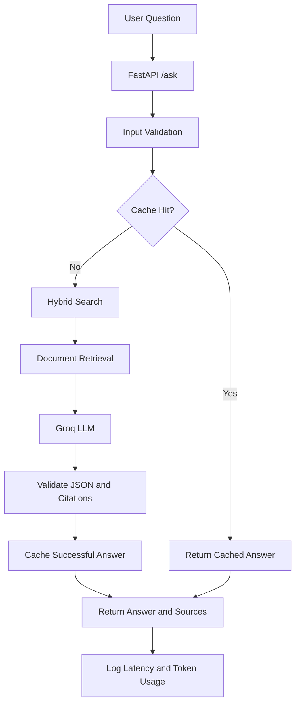

# MudraMitra

[](https://github.com/ShraddhaSomase/GenAI/actions/workflows/ci.yml)

> **Live API (Hugging Face Spaces):** https://shraddhasomase-mudramitra.hf.space/health

---

# About
MudraMitra is an AI-powered loan assistant for MUDRA (PMMY) and Stand-Up India schemes.  
It answers questions using RAG over official government PDFs, provides source citations,
runs a LangGraph agent with tool use, and surfaces a loan-amount picker that highlights
scheme categories and document disagreements.

---

## Quick start

### Local (venv)

```powershell
python -m venv .venv
.venv\Scripts\activate
pip install -r requirements.txt

# Terminal 1 — API
uvicorn app.main:app --reload

# Terminal 2 — UI
streamlit run ui/app.py
```

| Service | URL |
|---|---|
| FastAPI backend | http://127.0.0.1:8000 |
| Swagger docs | http://127.0.0.1:8000/docs |
| Streamlit UI | http://localhost:8501 |

---

## Run with Docker

```powershell
docker compose up --build
```

| Service | URL |
|---|---|
| FastAPI backend | http://localhost:8000 |
| Streamlit chat UI | http://localhost:8501 |
| Swagger docs | http://localhost:8000/docs |

```powershell
docker compose down   # stop
```

ChromaDB embeddings and agent SQLite memory persist in named Docker volumes.

---

## Live deployment

| What | URL |
|---|---|
| **API health check** | https://shraddhasomase-mudramitra.hf.space/health |
| **Swagger UI** | https://shraddhasomase-mudramitra.hf.space/docs |
| HF Space | https://huggingface.co/spaces/ShraddhaSomase/mudramitra |

---

## CI / CD

Every push and pull-request runs three GitHub Actions jobs:

| Job | What it checks |
|---|---|
| **Ruff lint** | `ruff check .` must pass |
| **Pytest** | All 46 tests must pass |
| **Docker build** | Both `Dockerfile` and `Dockerfile.ui` must build |

Workflow file: [`.github/workflows/ci.yml`](.github/workflows/ci.yml)

---

## Tests

46 pytest tests cover records, smart search, `/health`, `/records`, `/ask` with a fake LLM,
and agent tools (EMI calculator).

```powershell
python -m pytest tests/ -v
ruff check .
```

---

## API Endpoints

| Method | Path | Description |
|---|---|---|
| GET | `/health` | Health check — returns `{"status":"ok"}` |
| GET | `/records` | List all loan records (optional `?limit=N`) |
| GET | `/records/{id}` | Single record by position |
| GET | `/search?q=` | TF-IDF smart search |
| POST | `/questions` | Save a question |
| POST | `/chat` | Direct LLM chat |
| GET | `/search/semantic?q=` | ChromaDB semantic search |
| POST | `/ask` | RAG question answering with citations |
| POST | `/agent` | LangGraph agent with tool use + human approval |

---

## Day 8 — RAG Question Answering

Hybrid search (semantic + keyword, reciprocal rank fusion) over PMMY and Stand-Up India PDFs.

### Evaluation Results

| Metric | top_k=3 | top_k=5 |
|---|---:|---:|
| Answerability accuracy | 93.33% | 100.00% |
| Citation coverage | 91.67% | 100.00% |
| Source accuracy | 91.67% | 100.00% |
| Keyword accuracy | 40.25% | 63.83% |
| **Overall score** | 82.05% | **92.77%** |

---

## Checkpoint 2 — Loan Picker + Agent UI

### Features
- **Loan Amount Picker slider** — drag ₹10K–₹1Cr; matching PMMY band highlights instantly.
- **Stand-Up India** band activates for ₹10L–₹1Cr alongside the PMMY band.
- **Document-conflict note** — surfaces the 25% → 15% margin disagreement between source docs.
- **Dual mode**: RAG (fast, cited) or Agent (multi-step tool use with human approval).
- **Thumbs feedback** saved to `data/feedback.json`.

### Screenshot


---

## Git tags

| Tag | Contents |
|---|---|
| `checkpoint-1` | Day 1–5 records + search |
| `checkpoint-2` | Loan picker, agent UI, citations, feedback |
| `week-1` | Week 1 summary |

---

## Day 13 — Production Readiness

### Production features

- **Prompt-injection protection:** User questions and retrieved document content are treated as untrusted data. Instructions inside them cannot override the assistant's system rules.
- **Response caching:** Successful RAG answers are cached in memory to reduce repeated LLM calls.
- **Cache configuration:** Maximum 128 entries with a 5-minute expiration.
- **Request monitoring:** `/ask` logs request latency in milliseconds.
- **Token monitoring:** Logs prompt, completion, and total token usage when returned by the LLM provider.
- **Input validation:** Questions are limited to 2,000 characters.
- **Error handling:** Failed RAG requests return a controlled HTTP 502 response.

### Architecture



### Evaluation results

The existing RAG evaluation produced these results:

| Metric | top_k=3 | top_k=5 |
|---|---:|---:|
| Answerability accuracy | 93.33% | 100.00% |
| Citation coverage | 91.67% | 100.00% |
| Source accuracy | 91.67% | 100.00% |
| Keyword accuracy | 40.25% | 63.83% |
| **Overall score** | **82.05%** | **92.77%** |

### Automated testing

- Total automated tests: **50**
- Passing tests: **50**
- RAG endpoint, records, search, agent tools, caching, input validation, and prompt-injection safeguards are covered.

### Performance measurement

Request latency and token usage are logged by the API. Actual latency benchmarks and provider token measurements should be collected from real requests before publishing performance figures. Cache hits do not make a new LLM request.

