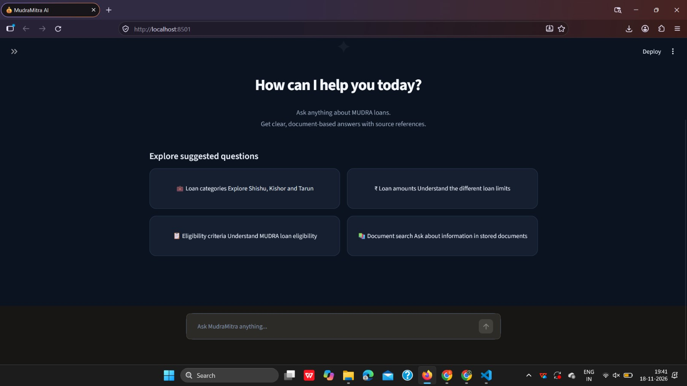

# MudraMitra 

# About
MudraMitra is a simple Python project that I am developing to manage financial records. The main aim is to make it easier to add, view, and manage basic money-related information.

# What it does
- Helps manage financial records.
- Provides a simple menu to interact with the program.
- Stores records using JSON.
- Uses basic Python concepts like functions, loops, and conditions.

## How to run

1. Create and activate a virtual environment (first time only):
   ```powershell
   python -m venv .venv
   .venv\Scripts\activate
   ```
2. Install the dependencies:
   ```powershell
   pip install -r requirements.txt
   ```
3. Start the API from the project root:
   ```powershell
   uvicorn app.main:app --reload
   ```
4. Open http://127.0.0.1:8000/docs to try the endpoints.

## Endpoints
| Method | Path | What it does |
| GET | `/health` | Health check |
| GET | `/records?limit=5` | List records (optional limit) |
| GET | `/records/{id}` | One record, 404 if missing |
| GET | `/search?q=rent` | Top 3 records ranked by TF-IDF + cosine similarity |
| POST | `/questions` | Save a user question to `data/questions.json` |

## Other scripts
python analysis/explore.py     # 3 facts about the data (pandas)
python -m app.smart_search     # try the ranking in the terminal
python -m app.cli              # Day 2 menu
```


## Day 8 - RAG Question Answering

MudraMitra now uses Retrieval-Augmented Generation (RAG) to answer questions using PDF documents.

## New Features
- Hybrid search combines semantic search and keyword matching.
- ChromaDB stores document embeddings.
- Groq LLM generates answers using retrieved document context.
- Answers include source, page number, and chunk ID citations.
- The system refuses questions when information is unavailable.

## New API Endpoint

| Method | Path | Description |
|---|---|---|
| POST | /ask | Answer questions using RAG with citations |

## Run RAG Evaluation

python -m eval.run_eval

### Evaluation Results

| Metric | top_k = 3 | top_k = 5 |
|---|---:|---:|
| Answerability accuracy | 93.33% | 100.00% |
| Citation coverage | 91.67% | 100.00% |
| Source accuracy | 91.67% | 100.00% |
| Keyword accuracy | 40.25% | 63.83% |
| Overall score | 82.05% | 92.77% |

**Best configuration: top_k = 5**

Detailed results: eval/eval_results.json


## Day 10 - MudraMitra Chat Interface

Built a Streamlit chat interface connected to the FastAPI backend.

### Features
- Interactive chatbot for asking MUDRA-related questions.
- RAG-based answers using PDF documents.
- Source citations with page numbers and chunk IDs.
- Thumbs up/down feedback system.
- Feedback stored in JSON format.

### Chatbot Screenshot



