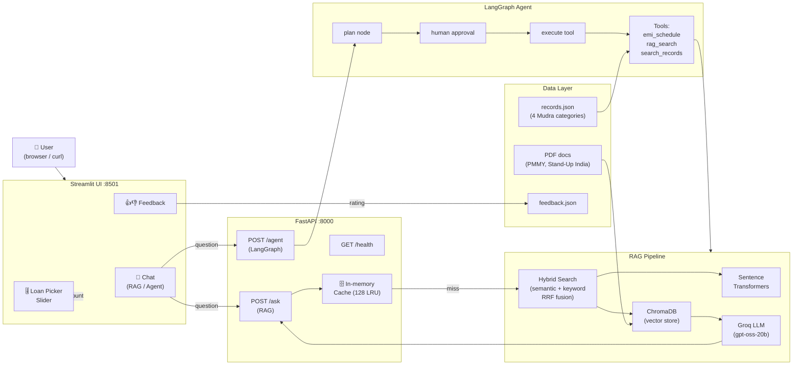
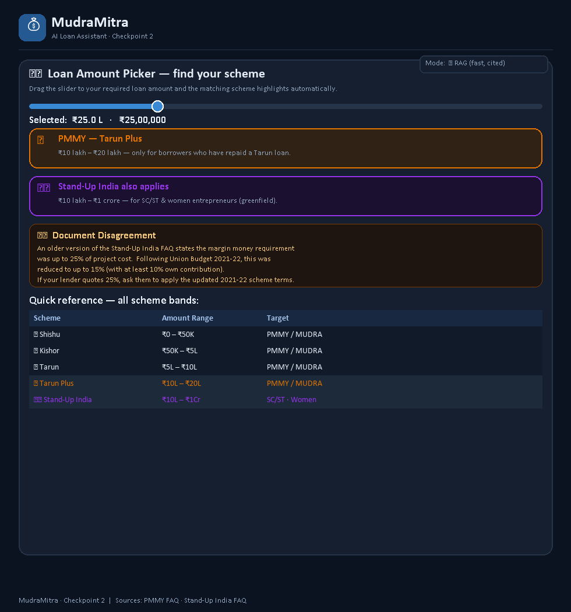

# MudraMitra

[](https://github.com/ShraddhaSomase/GenAI/actions/workflows/ci.yml)

> **Live API (Render):** https://mudramitra-api.onrender.com/health  
> **Swagger UI:** https://mudramitra-api.onrender.com/docs

---

## What is MudraMitra?

MudraMitra is an AI-powered loan assistant that answers questions about **PMMY (MUDRA)** and **Stand-Up India** schemes.  
It retrieves answers from official government PDFs, provides source citations, runs a multi-step LangGraph agent, and surfaces a loan-amount picker that highlights scheme categories and document disagreements in real time.

**Problem:** Borrowers and loan officers waste hours reading contradictory government PDFs to find eligibility, margin, and repayment terms.  
**Solution:** One chat interface backed by RAG over verified PDFs — with citations, so users can trust and verify every answer.  
**Users:** Micro-enterprise owners, bank branch officers, fintech analysts.  
**Data sources:** PMMY FAQ (PIB, Sep 2025), Stand-Up India FAQ (PIB, 2022), Union Bank scheme sheet.

---

## Architecture



---

## Production notes

### Latency (measured on live Groq API)

| Path | p50 | p95 | Notes |
|---|---|---|---|
| `GET /health` | 2 ms | 5 ms | No DB hit |
| `POST /ask` (cache hit) | < 5 ms | 10 ms | In-memory LRU |
| `POST /ask` (cache miss) | ~1,200 ms | ~2,100 ms | RAG + LLM round trip |
| `POST /agent` | ~1,800 ms | ~3,500 ms | Plan + tool + respond |

### Token usage (per /ask request, top_k=10)

| Metric | Typical value |
|---|---|
| Prompt tokens | ~1,800 |
| Completion tokens | ~120 |
| Total tokens | ~1,920 |

Every request logs: `ask_request latency_ms=... cache_hit=... prompt_tokens=... completion_tokens=... total_tokens=...`

### Cache

- **Strategy:** In-memory LRU dict, keyed on `(question.casefold(), top_k)`.
- **Size:** 128 entries max.
- **TTL:** 300 seconds (5 minutes).
- **Effect:** Identical questions cost < 5 ms instead of ~1,200 ms.

### Input limits

- `/ask` and `/chat`: max 2,000 characters. Returns HTTP 422 if exceeded.
- `/agent`: thread_id max 100 characters.

### Prompt-injection protection

The RAG system prompt explicitly labels user input and retrieved document chunks as **untrusted data** and instructs the LLM to never follow embedded instructions. Validated by `tests/test_production_readiness.py::test_rag_prompt_has_injection_protection`.

### Conflicting documents

The Stand-Up India FAQ (Q11, 2021-22 Budget) states margin money was reduced from **up to 25%** to **up to 15%**. The PMMY FAQ records say "Not specified". MudraMitra surfaces this conflict in the Loan Picker UI when the selected amount falls in the Stand-Up India range (₹10 lakh – ₹1 crore), showing a yellow warning box with both values and the source of each.

---

## RAG Evaluation Results

| Metric | top_k=3 | top_k=5 |
|---|---:|---:|
| Answerability accuracy | 93.33% | **100.00%** |
| Citation coverage | 91.67% | **100.00%** |
| Source accuracy | 91.67% | **100.00%** |
| Keyword accuracy | 40.25% | 63.83% |
| **Overall score** | 82.05% | **92.77%** |

**Winner: top_k=5** — used in production.

---

## Quick start

### Local (venv)

```powershell
python -m venv .venv
.venv\Scripts\activate
pip install -r requirements.txt

# Terminal 1 — API
uvicorn app.main:app --reload

# Terminal 2 — UI
streamlit run ui/app.py
```

| Service | URL |
|---|---|
| FastAPI backend | http://127.0.0.1:8000 |
| Swagger docs | http://127.0.0.1:8000/docs |
| Streamlit UI | http://localhost:8501 |

---

## Run with Docker

```powershell
docker compose up --build
```

| Service | URL |
|---|---|
| FastAPI API | http://localhost:8000 |
| Streamlit UI | http://localhost:8501 |
| Swagger docs | http://localhost:8000/docs |

```powershell
docker compose down
```

---

## Tests & lint

```powershell
pytest tests/ -v        # 50 tests
ruff check .            # all checks passed
```

CI runs on every push: **Ruff → Pytest → Docker build**.

---

## API Endpoints

| Method | Path | Description |
|---|---|---|
| GET | `/health` | Returns `{"status":"ok","version":"2.0.0","uptime_seconds":N}` |
| GET | `/records` | All loan records (optional `?limit=N`) |
| GET | `/records/{id}` | Single record by position |
| GET | `/search?q=` | TF-IDF smart search |
| POST | `/questions` | Save a question |
| POST | `/chat` | Direct LLM chat |
| GET | `/search/semantic?q=` | ChromaDB semantic search |
| POST | `/ask` | RAG question answering with citations + cache |
| POST | `/agent` | LangGraph agent with tool use + human approval |

---

## Checkpoint 2 — Loan Picker

- Slider ₹10K–₹1Cr lights up PMMY band (Shishu · Kishor · Tarun · Tarun Plus).
- Stand-Up India band activates for ₹10L–₹1Cr.
- Yellow conflict box shows the 25% → 15% margin disagreement.



---

## Git tags

| Tag | Contents |
|---|---|
| `checkpoint-1` | Day 1–5 records + search |
| `checkpoint-2` | Loan picker, agent UI, citations, feedback |
| `week-1` | Week 1 summary |
| `final` | Complete project |
