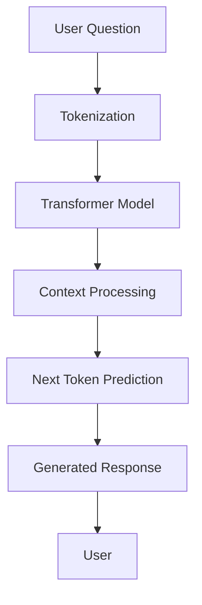

# How LLMs Work

## 1. What is an LLM?

LLM stands for Large Language Model. It is an AI model that understands and generates human language.

LLMs are trained using large amounts of text, such as books, articles, websites, and other text data. They learn patterns in language and use those patterns to generate responses.

Examples of LLMs include GPT, Gemini, Claude, and Llama.

## 2. How does an LLM work?

An LLM works in the following steps:

1. **Input:** The user enters a question or message.
2. **Tokenization:** The text is divided into smaller units called tokens.
3. **Processing:** The model processes the tokens using a neural network architecture called Transformer.
4. **Context understanding:** The model uses the surrounding text to understand what response is relevant.
5. **Prediction:** The model predicts the next token based on the previous tokens.
6. **Output:** The predicted tokens are combined to generate a complete response.

## 3. LLM Working Diagram

## 4. What is a Transformer?

A Transformer is a deep learning architecture used by modern LLMs.

It uses an attention mechanism to understand relationships between different words or tokens in a sentence.

For example, in the sentence "The bank approved my loan", the model uses context to understand that bank refers to a financial institution.

## 5. What is a Token?

A token is a small piece of text processed by an LLM.

A token can be:
- A complete word.
- Part of a word.
- A punctuation mark.
- A number.

The model processes text as tokens rather than directly processing complete sentences.

## 6. What is Prompt Engineering?

Prompt engineering means writing clear instructions or questions to get better responses from an LLM.

For example:

- Poor prompt: Tell me about loans.
- Better prompt: Explain the loan approval process in simple language.

A clear prompt helps the model understand the user's requirement.

## 7. What is RAG?

RAG stands for Retrieval-Augmented Generation.

It combines information retrieval with an LLM to generate answers using external data.

RAG works in these steps:

1. The user asks a question.
2. The system searches relevant information from a dataset or knowledge base.
3. Relevant information is retrieved.
4. The retrieved information is given to the LLM as context.
5. The LLM generates an answer based on the available information.

RAG helps reduce incorrect answers by providing relevant information to the model.

## 8. LLM vs RAG

| LLM | RAG |
|---|---|
| Generates answers using learned patterns. | Retrieves information before generating answers. |
| May not know private or updated data. | Can use an external dataset. |
| Can sometimes generate incorrect information. | Can improve factual accuracy using retrieved context. |

## 9. What is an LLM Hallucination?

Hallucination happens when an LLM generates information that sounds correct but is actually incorrect or unsupported.

For example, if a loan dataset does not contain a rejection reason, the chatbot should not invent a reason for rejecting the loan.

## 10. How will we use LLMs in our project?

In our loan record application, we plan to use an LLM to understand users' questions and generate easy-to-understand answers.

Our application will use loan records containing information such as:

- Application ID
- Annual income
- Employment years
- Credit score
- Loan amount
- Loan purpose
- Loan decision
- Interest rate
- Monthly payment
- Loan status

We can use FastAPI as the backend to receive questions and return responses.

In the future, we can integrate RAG so the chatbot retrieves relevant loan records before generating an answer.

## 11. Conclusion

LLMs help computers understand and generate human language. By combining an LLM with FastAPI and our loan dataset, we can build a chatbot that answers users' questions in simple language. RAG can help the chatbot provide answers based on actual available records instead of making up information.